  

# 🧠 Awesome AI Evaluation & Cognitive Testing 🧪

**The Definitive Curated Registry of SaaS Observability Platforms & Open-Source LLM Evaluation Suites**

*Master LLM evaluation harnesses, multi-agent cognitive testing, hallucination scoring, RAG triad benchmarks, LLM-as-a-judge pipelines, and adversarial red-teaming.*

**Last updated:** November 2026

---

## 📖 Overview & SEO Summary 🔍

Modern LLM-powered applications and autonomous AI agents require rigorous, continuous, and automated testing beyond traditional software unit tests. **AI Evaluation & Cognitive Testing** encompasses offline pre-deployment regression benchmarks, runtime OpenTelemetry tracing, synthetic adversarial probing, calibration testing, epistemic uncertainty measurement, and continuous online guardrails.

This directory provides a state-of-the-art index of **commercial SaaS observability tools** and **battle-tested open-source libraries** across:
- 🎯 **Cognitive & Reasoning Harnesses**: Testing multi-step reasoning, tool invocation accuracy, spatial logic, and planning integrity.
- 📐 **RAG & Faithfulness Metrics**: Measuring context retrieval precision, context recall, answer groundedness, and hallucination rates.
- ⚖️ **LLM-as-a-Judge Automation**: Scaling human evaluation pipelines with synthetic judges, pairwise scoring, and rubric calibrations.
- 🛡️ **Safety, Security & Red-Teaming**: Probing for prompt injections, jailbreaks, data leakage, toxic outputs, and model unalignment.
- 📊 **Agentic Observability & Tracing**: Distributed tracing of multi-turn tool loops, agent memory state transitions, latency, and token economics.

---

## 📑 Table of Contents 📌

- [📊 Sector Overview & Market Dynamics](#-sector-overview--market-dynamics)
- [🏢 SaaS & Hosted Enterprise Platforms](#-saas--hosted-enterprise-platforms)
- [🔓 Open-Source GitHub Projects](#-open-source-github-projects)
  - [⭐ Top Open-Source Frameworks (Ranked by Stars)](#-top-open-source-frameworks-ranked-by-stars)
  - [🔬 Additional Specialized Benchmarks & Toolkits](#-additional-specialized-benchmarks--toolkits)
- [🤝 How to Contribute](#-how-to-contribute)
- [💖 Support & Sponsorship](#-support--sponsorship)
- [📈 Star History](#-star-history)
- [📜 Disclaimer](#-disclaimer)

---

## 📊 Sector Overview & Market Dynamics 📈

The global **AI Evaluation, Observability & Guardrails** market is valued at approximately **$1.8B – $4.1B** and is projected to expand to **$14B – $27B+ by the mid-2030s** at an aggressive CAGR of **~23%**, driven by the enterprise shift from experimental LLM prototypes to mission-critical multi-agent autonomous deployments. 

Historically **fragmented** with dozens of venture-backed point-solution startups focusing exclusively on prompt playground evaluations or hallucination scoring, the sector is rapidly transitioning into a **consolidated oligopoly** as hyperscalers, foundation model providers, and APM titans (such as Dynatrace acquiring Arize AI for $915M and CrowdStrike acquiring Fiddler AI for ~$400M) integrate specialized evaluation loops directly into unified infrastructure and security suites.

---

## 🏢 SaaS & Hosted Enterprise Platforms ☁️

The following enterprise platforms offer managed cloud architectures, dataset curation sandboxes, collaborative human annotation workspaces, and real-time production guardrails.

*Sorted in descending order by company size (Valuation / Acquisition Price / Capital Raised):*

| Product / Company | Company Scale (Valuation / Capital) | Pricing (Starting Paid Tier) | Free Tier / Trial Limits | Core Focus & Differentiating Strengths |
| :--- | :--- | :--- | :--- | :--- |
| **[LangSmith](https://langchain.com)** (LangChain) | **$3.0 Billion** valuation *(Series C, $460M raised)* | **$39/seat/month** (*Plus* plan, + usage overages) | **Free Developer Plan**: 1 seat, 5,000 base traces/month, 14-day data retention, 50k events/hour rate limit | Comprehensive agent tracing, experiment runs, prompt playground, dataset curation, and offline/online judge scoring. |
| **[Arize AX](https://arize.com)** (Arize AI) | **$915 Million** *(Acquired by Dynatrace; $131M raised)* | **$50/month** (*AX Pro* plan) | **Free AX Plan**: 25,000 trace spans/month, 1 GB storage ingestion, 15-day data retention, 1 space, 10 Signal issues/month | OpenTelemetry-native distributed tracing, drift detection, vector embeddings visualization, and automated evaluator loops. |
| **[Braintrust](https://braintrust.dev)** | **$800 Million** valuation *(Series B, $121M raised)* | **$249/month** (*Pro* plan, includes $100 model credits & 50k scores) | **Free Starter Plan**: 10,000 scores/month, 1 GB processed data/month, $10 model credits, 14-day retention, unlimited users | Enterprise CI/CD evaluation harness, dataset versioning, proxy caching, fast playground, and LLM regression tracking. |
| **[Fiddler AI](https://fiddler.ai)** | **$400 Million** *(Acquired by CrowdStrike; $100M raised)* | **$0.002/trace** (*Developer* plan) | **Free Plan**: Real-time safety guardrails (Centor models for PII/PHI, toxicity, prompt injection, and jailbreaks; latency &lt;80ms) | Real-time guardrail enforcements, AI safety audits, fairness/bias auditing, enterprise governance, and continuous drift monitoring. |
| **[Galileo](https://rungalileo.io)** | **$100M – $250M** est. valuation *($68M raised, Series B)* | **$100/month** (*Pro* plan, billed annually; 50,000 traces/mo) | **Free Developer Plan**: 5,000 traces/month, unlimited users, unlimited custom evaluators, community support | Fine-grained RAG attribution analytics, proprietary hallucination metrics (ChainPoll), agentic error clustering, and real-time guardrails. |
| **[Patronus AI](https://patronus.ai)** | **$70 Million** raised *(Series B led by Greenfield Partners)* | **Usage-based API**: $10/1k small evaluator calls, $20/1k large evaluator calls | **Free Developer Plan**: $10 complimentary API credits, 2 projects, 5 experiments/project, 14-day retention, unlimited datasets | Automated adversarial evaluation, custom LLM hallucination judge (Lynx), finance/compliance benchmarking, and automated red-teaming. |
| **[Vellum](https://vellum.ai)** | **$25.5 Million** raised *(Series A led by Leaders Fund)* | **$30/month** (*Mighty* entry tier; Enterprise platform via custom sales quote) | **Free Base Plan**: $0 forever for personal/base instances (1 vCPU, 2 GiB RAM, 6 GiB persistent storage, pay-as-you-go API credentials) | Quantitative multi-model evaluation matrices, prompt engineering sandboxes, versioned LLMOps workflows, and test case management. |
| **[Humanloop](https://humanloop.com)** | **Acqui-hired by Anthropic** *($7.9M raised total)* | Custom enterprise contracts *(Platform sunset post-acquisition)* | **Historical Free Tier**: 2 team members, 50 evaluation runs/month, 10,000 logs/month | Collaborative prompt workspace, human-in-the-loop annotation workflows, custom evaluators, and blind A/B comparative testing. |
| **[HoneyHive](https://honeyhive.ai)** | **$7.4 Million** raised *(Seed led by Insight Partners)* | Custom Enterprise quotation based on volume &amp; dedicated hosting | **Free Developer Plan**: 10,000 events/month, 1,000 requests/minute max, 30-day retention, up to 5 user seats, 1 workspace | Agent evaluation pipelines, user session trajectory tracing, prompt versioning, CI/CD regression gates, and production feedback curation. |
| **[Confident AI](https://confident-ai.com)** (DeepEval Cloud) | **$2.7 Million** raised *(Seed backed by Y Combinator W25)* | **$200/month** (*Starter* plan, unlimited seats, 5 projects, 5 GB-mo) | **Free Plan**: 2 user seats, 1 project, 5 test runs/week, 1 GB-month trace spans, 1-week data retention | Cloud evaluation cockpit powered by DeepEval, synthetic test data generation, hosted adversarial red-teaming, and CI/CD test reports. |

---

## 🔓 Open-Source GitHub Projects 💻

Self-hostable, transparent, and extensible frameworks for unit-testing, automated cognitive benchmarking, and OpenTelemetry tracing.

### ⭐ Top Open-Source Frameworks (Ranked by Stars) 🏆

*Sorted in descending order by live GitHub stargazers count:*

1. **[Langfuse](https://github.com/langfuse/langfuse)**   
   *Open-source (`MIT`) LLM engineering and observability platform.* Features dataset experiment runs, LLM-as-a-judge scoring, latency/token cost tracking, user feedback capture, and seamless OpenTelemetry instrumentation for AI agents.

2. **[Promptfoo](https://github.com/promptfoo/promptfoo)**   
   *Lightweight, high-speed open-source (`MIT`) CLI & testing library.* Built for declarative LLM prompt evaluation, side-by-side model matrix comparisons, automated adversarial red-teaming, CI/CD pipeline gating, and hallucination assertions.

3. **[Opik](https://github.com/comet-ml/opik)**   
   *End-to-end open-source (`Apache-2.0`) LLM evaluation, observability, and tracing platform from Comet.* Built to log production agent trajectories, evaluate complex reasoning steps with custom heuristic and LLM judges, and manage structured evaluation datasets.

4. **[Guidance](https://github.com/guidance-ai/guidance)**   
   *Language for controllable generation and structural evaluation (`Apache-2.0`).* Enables constrained regex/grammar validation, token-level probability scoring, and deterministic structured output guarantees for cognitive LLM pipelines.

5. **[OpenAI Evals](https://github.com/openai/evals)**   
   *OpenAI's foundational evaluation harness and benchmark registry (`MIT`).* Provides tools for authoring custom deterministic, model-graded, and multi-turn capabilities tests, powering both internal alignment and community evaluations.

6. **[DeepEval](https://github.com/confident-ai/deepeval)**   
   *The "Pytest for LLMs" open-source (`Apache-2.0`) evaluation framework.* Ships 40+ research-backed metrics covering agent tool-calling correctness, RAG faithfulness, answer relevancy, contextual recall, hallucination detection, and automated red-teaming.

7. **[Ragas](https://github.com/explodinggradients/ragas)**   
   *The gold-standard open-source (`Apache-2.0`) RAG evaluation framework.* Specializes in measuring the RAG Triad (Faithfulness, Answer Relevance, Context Precision, and Context Recall) combined with synthetic test-dataset generator algorithms.

8. **[LM Evaluation Harness](https://github.com/EleutherAI/lm-evaluation-harness)**   
   *The industry benchmark suite from EleutherAI (`MIT`).* Powers the Hugging Face Open LLM Leaderboard with 60+ academic cognitive, reasoning, commonsense, math, and knowledge benchmarks (`MMLU`, `GSM8K`, `ARC`, `HellaSwag`, `TruthfulQA`).

9. **[Arize Phoenix](https://github.com/Arize-ai/phoenix)**   
   *Open-source (`ELv2`) OpenTelemetry-native AI observability and evaluation suite.* Features zero-dependency local UI, trace waterfalls, pre-built LLM-as-a-judge evaluators, embedding drift analysis, and multi-step agent trajectory inspection.

10. **[Garak](https://github.com/NVIDIA/garak)**   
    *LLM vulnerability scanner and red-teaming probe suite from NVIDIA (`Apache-2.0`).* Systematically checks models for jailbreaks, prompt injection, hallucination vulnerability, toxic language, data leakage, and adversarial extraction attacks.

11. **[SWE-bench](https://github.com/SWE-bench/SWE-bench)**   
    *Real-world software engineering cognitive benchmark (`MIT`).* Tests autonomous coding agents on resolving genuine, multi-file GitHub issues inside Dockerized environments with ground-truth test-suite verifications.

12. **[Giskard](https://github.com/Giskard-AI/giskard-oss)**   
    *Automated QA and security testing framework for LLMs and tabular AI (`Apache-2.0`).* Detects hallucinations, biases, prompt injections, and data leakages with automated scanning heuristics and customizable domain test assertions.

13. **[Agenta](https://github.com/Agenta-AI/agenta)**   
    *Open-source (`MIT`) developer-first LLM evaluation and prompt experimentation platform.* Features collaborative prompt management, human-in-the-loop blind A/B comparative reviews, and automated evaluator workflows.

14. **[AgentBench](https://github.com/THUDM/AgentBench)**   
    *Multi-dimensional benchmark for evaluating LLMs as autonomous agents (`Apache-2.0`).* Assesses agentic reasoning across 8 distinct interactive environments including OS bash navigation, database querying, web browsing, and multi-turn games.

15. **[TruLens](https://github.com/truera/trulens)**   
    *Open-source (`MIT`) evaluation and tracking tool from TruEra.* Evaluates LLM/RAG pipelines using the RAG Triad feedback functions (Groundedness, Context Relevance, Answer Relevance) with automated regression dashboards.

16. **[Inspect AI](https://github.com/UKGovernmentBEIS/inspect_ai)**   
    *State-of-the-art evaluation framework created by the UK AI Security Institute (`MIT`).* Designed for high-assurance cognitive reasoning, sandboxed agent tool-use evaluations, cyber-capability assessments, and frontier AI safety benchmarking.

17. **[OSWorld](https://github.com/xlang-ai/OSWorld)**   
    *Benchmarking multimodal agents on open-ended computer tasks (`Apache-2.0`).* Measures autonomous OS-level mouse, keyboard, and application interaction across Ubuntu, Windows, and macOS operating environments.

18. **[BIG-bench](https://github.com/google/BIG-bench)**   
    *Beyond the Imitation Game Benchmark by Google Research (`Apache-2.0`).* Collaborative benchmark comprising 200+ distinct cognitive tasks designed to probe the extreme outer boundaries and emergent reasoning capabilities of language models.

19. **[HELM](https://github.com/stanford-crfm/helm)**   
    *Holistic Evaluation of Language Models by Stanford CRFM (`Apache-2.0`).* Standardizes evaluation across accuracy, calibration, robustness, fairness, bias, toxicity, efficiency, and copyright parameters across foundational models.

20. **[LightEval](https://github.com/huggingface/lighteval)**   
    *Hugging Face's lightweight, distributed evaluation toolkit (`MIT`).* Supports vLLM, Nanotron, and Transformers acceleration backends with seamless integration into the Hugging Face ecosystem and custom benchmark authoring.

21. **[EvalPlus](https://github.com/evalplus/evalplus)**   
    *Rigorous code generation evaluation framework (`Apache-2.0`).* Augments HumanEval (`HumanEval+`) and MBPP (`MBPP+`) with 80x more rigorous automated test cases to uncover subtle logic bugs and brittle model generations.

22. **[MLE-bench](https://github.com/openai/mle-bench)**   
    *Benchmark from OpenAI for machine learning engineering capabilities (`MIT`).* Tests autonomous AI agents on 75 realistic Kaggle competitions to evaluate end-to-end data preparation, model training, and hyperparameter tuning skills.

23. **[Curator](https://github.com/bespokelabsai/curator)**   
    *Open-source synthetic evaluation and data curation framework (`Apache-2.0`).* Engineered for synthesizing, curating, filtering, and de-duplicating high-fidelity cognitive reasoning datasets for post-training and eval suites.

24. **[Rebuff](https://github.com/protectai/rebuff)**   
    *Prompt injection detection and safety evaluation framework (`Apache-2.0`).* Multi-layered defense engine employing heuristic checks, vector database canary injection matching, and specialized LLM detection models.

25. **[TAU-bench](https://github.com/sierra-research/tau-bench)**   
    *Agentic benchmark from Sierra Research (`MIT`).* Measures multi-turn tool-calling reliability, dynamic API interactions, database state consistency, and customer service conversational policies.

26. **[Prometheus-Eval](https://github.com/prometheus-eval/prometheus-eval)**   
    *Open-source judge model evaluation library (`Apache-2.0`).* Evaluates fine-grained LLM-as-a-judge scoring using dedicated open-weight Prometheus models, providing transparent scoring rubrics and reference-grounded feedback.

27. **[AutoEvals](https://github.com/braintrustdata/autoevals)**   
    *Lightweight open-source collection of LLM evaluation functions (`MIT`) from Braintrust.* Includes battle-tested scoring functions for SQL validity, JSON correctness, semantic similarity, toxicity, and factuality.

28. **[Calibrain Harness](https://github.com/zadescoxp/calibrain-harness)**   
    *Cognitive calibration and uncertainty evaluation harness (`Apache-2.0`).* Probes model confidence calibration, Brier scores, epistemic vs. aleatoric uncertainty, and cognitive reasoning reliability under deceptive prompts.

29. **[PyRIT](https://github.com/Azure/PyRIT)**   
    *Python Risk Identification Tool for Generative AI by Microsoft (`MIT`).* Automates multi-turn adversarial red-teaming, jailbreak attack testing, and safety harm identification across multimodal AI models.

30. **[OLMo-Eval](https://github.com/allenai/olmo-eval)**   
    *Open-source evaluation engine from the Allen Institute for AI (`Apache-2.0`).* Provides reproducible, distributed evaluations for open-weights frontier LLMs across core academic benchmarks and zero-shot reasoning datasets.

---

### 🔬 Additional Specialized Benchmarks & Toolkits 🛠️

- **[DeepMind Lab / Evaluation Suites](https://github.com/deepmind)**: Reinforcement learning and cognitive task environments probing spatial reasoning, memory, and navigation.
- **[Hugging Face Open LLM Leaderboard 2](https://huggingface.co/spaces/open-llm-leaderboard/open_llm_leaderboard)**: The preeminent community benchmark tracker measuring open models on `IFEval`, `BBH`, `MATH`, `GPQA`, `MuSR`, and `MMLU-Pro`.
- **[LMSYS Chatbot Arena](https://chat.lmsys.org/)**: Crowdsourced open platform utilizing the Bradley-Terry Elo rating system over millions of blind pairwise human preference battles.
- **[MT-Bench](https://github.com/lm-sys/FastChat/tree/main/fastchat/llm_judge)**: Multi-turn conversational evaluation benchmark testing instruction-following across 8 categories (writing, roleplay, reasoning, math, coding, extraction, STEM, humanities).
- **[AlpacaEval](https://github.com/tatsu-lab/alpaca_eval)**: Fast, automated, cost-effective benchmark testing instruction-following models against GPT-4 or Claude 3.5 Sonnet references with length-bias mitigation.

---

## 🤝 How to Contribute 🚀

Contributions, updates, and corrections are warmly welcomed! To suggest a new SaaS product, open-source repository, or benchmark harness:

1. 🍴 **Fork** this repository.
2. 🌿 **Create a descriptive feature branch** (`git checkout -b add-tool-name`).
3. ✍️ **Add your entry** under the appropriate section:
   - For **SaaS tools**: Provide exact company scale data, verified starting tier pricing, and clear free-tier limits.
   - For **Open-Source tools**: Include a social Stars_Badge linking to the repository's stargazers page and ensure proper categorization.
4. 📝 **Maintain alphabetical or sorted order** as specified.
5. 🚀 **Submit a Pull Request** with a brief summary of the project and official documentation links.

---

## 💖 Support & Sponsorship ☕

If you find this curated ecosystem helpful for your AI evaluation, agent testing, or research workflows, please consider supporting the project:

- ⭐ **Star this repository** to help other engineers, researchers, and builders discover it!
- 🍴 **Fork it** and build your own tailored internal eval guide!
- 📢 **Share it** on X / Twitter, LinkedIn, and developer discords.
- ☕ **Sponsor the author / Buy a coffee**: Support ongoing curation and maintenance via the **[GitHub Sponsor Dashboard](https://github.com/sponsors/ishandutta2007)**!

---

## 📈 Star History 🌟

---

## 📜 Disclaimer ⚖️

This list is curated for research, informational, and educational purposes. Product names, logos, benchmarks, and trademarks are the property of their respective owners. Pricing plans, free tier quotas, and corporate valuations fluctuate over time; verify current production terms on official vendor websites before provisioning enterprise licenses.
